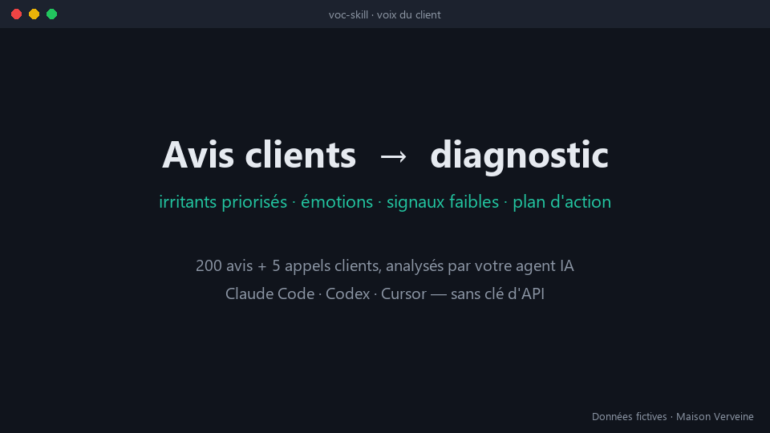

# voc-skill · Voix du client / Voice of the Customer

[](https://github.com/custovox/voc-skill/actions/workflows/tests.yml)
[](LICENSE)


**[Français](#français) · [English](#english)**

---

## Français

**Transformez vos avis clients, verbatims et transcriptions d'appels en un diagnostic clair : irritants priorisés, émotions, signaux faibles et plan d'action, en quelques minutes et sans clé d'API.**

<p align="center"></p>

### Ce que ça fait

Vous donnez un fichier (CSV, Excel, JSON, texte, transcriptions) à votre agent IA (Claude Code, Codex, Cursor) et vous demandez une analyse. L'agent :

1. **charge et anonymise** les données (noms, e-mails, téléphones, adresses, IBAN, numéros de commande) **avant toute lecture** ;
2. **décrit** le corpus : volumes, canaux, périodes, notes ;
3. **identifie les thèmes et irritants**, qualifie le **sentiment et les émotions** ;
4. repère les **signaux faibles** (rares mais nouveaux, graves ou en hausse) ;
5. choisit des **citations représentatives** ;
6. **priorise** les irritants : fréquence × intensité, en 4 quadrants ;
7. propose un **plan d'action** (horizon, responsable, indicateur) ;
8. produit un **rapport Markdown** et un **fichier JSON** réutilisable.

L'analyse sémantique est faite par l'agent lui-même : **aucune clé d'API, aucun envoi de vos données vers un service tiers** autre que l'agent que vous utilisez déjà.

👉 Exemple de rapport obtenu sur des données fictives : [examples/rapport/rapport_demo.md](examples/rapport/rapport_demo.md)

### Installation pas à pas

#### Étape 1 · Installer `uv` (une seule fois)

`uv` lance le petit serveur Python de l'outil et installe ses dépendances automatiquement.

- **Windows** : ouvrez *PowerShell* et collez :
  ```powershell
  powershell -ExecutionPolicy ByPass -c "irm https://astral.sh/uv/install.ps1 | iex"
  ```
- **macOS / Linux** : ouvrez le *Terminal* et collez :
  ```bash
  curl -LsSf https://astral.sh/uv/install.sh | sh
  ```

Fermez puis rouvrez le terminal.

#### Étape 2 · Installer l'outil

**Option A · Claude Code (le plus simple)** : dans Claude Code, tapez ces deux commandes :

```
/plugin marketplace add custovox/voc-skill
/plugin install voc-skill@custovox-voc
```

Redémarrez Claude Code. Le skill et le serveur MCP sont installés ensemble.

**Option B · Script d'installation (Claude Code, Codex, Cursor)**

1. Téléchargez le dépôt : bouton vert **Code → Download ZIP**, puis décompressez-le dans un dossier qui ne bougera plus (par exemple `Documents\voc-skill`).
2. Lancez le script :
   - **Windows** : clic droit dans le dossier → *Ouvrir dans le terminal*, puis
     ```powershell
     powershell -ExecutionPolicy Bypass -File install\install.ps1
     ```
   - **macOS / Linux** :
     ```bash
     bash install/install.sh
     ```
3. Le script copie le skill pour Claude Code (`~/.claude/skills`) et pour Codex et Cursor (`~/.agents/skills`), enregistre le serveur dans Claude Code s'il est installé, et affiche les quelques lignes à coller dans la configuration de Codex (`~/.codex/config.toml`) ou de Cursor (`~/.cursor/mcp.json`).

**Option C · Copie manuelle du skill seul** : copiez le dossier `skills/voix-du-client` dans `~/.claude/skills/` (Claude Code) ou `~/.agents/skills/` (Codex, Cursor). Le skill fonctionne sans le serveur, en mode réduit (l'agent lit et anonymise lui-même).

### Exemples de requêtes

- « Analyse les avis clients de `avis.csv` avec le skill voix-du-client et sors-moi le rapport. »
- « Quels sont les 3 irritants à traiter en priorité dans nos tickets du trimestre ? »
- « Compare les verbatims de mars et d'avril : qu'est-ce qui a changé ? »
- « Y a-t-il des signaux faibles liés à la sécurité ou à la santé dans ces retours ? »
- « Fais un échantillon stratifié de 300 verbatims sur ce fichier de 20 000 lignes et analyse-le. »
- « Analyse the reviews in `reviews.xlsx` and write the report in English. »

Essayez tout de suite avec les données fictives fournies : « Analyse le dossier `examples/data` avec le skill voix-du-client. »

### Outils du serveur MCP

| Outil | Rôle |
|---|---|
| `load_feedback` | Lit CSV, XLSX, JSON, TXT ou un dossier ; détecte les colonnes texte, date, note, canal (ou les impose) ; **anonymise par défaut** |
| `anonymize` | Masque les données personnelles d'un texte ou d'un jeu de données |
| `stats` | Volumes, période, répartition par canal, par mois (avec note moyenne) et par note |
| `sample` | Échantillon stratifié reproductible pour les gros fichiers (au moins 1 verbatim par segment) |
| `export_report` | Rapport Markdown + JSON ; calcule les scores fréquence × intensité et les quadrants |
| `transcribe` *(option)* | Transcription d'appels avec séparation agent / client (FunASR, Whisper large-v3 turbo, français et anglais) |

**Audio (optionnel)** : la transcription demande PyTorch et environ 1,6 Go de modèles. Dans le dossier du dépôt : `uv sync --extra audio`. L'outil `transcribe` n'apparaît que si cette option est installée.

### Données personnelles (RGPD)

- L'anonymisation est **activée par défaut** et appliquée **avant** l'analyse, puis une seconde fois sur les citations du rapport.
- Elle repose sur des règles (formats français et anglais) : c'est un **masquage au mieux**, pas une garantie. Relisez les citations avant de diffuser un rapport.
- Elle peut masquer par excès des références métier (numéros de lot, par exemple).
- Vos fichiers restent sur votre machine ; seul l'agent que vous utilisez lit les verbatims anonymisés.

### Structure du dépôt

```
voc-skill/
├── .claude-plugin/          # plugin.json + marketplace.json (installation Claude Code)
├── .mcp.json                # déclaration du serveur MCP pour le plugin
├── skills/voix-du-client/   # le skill : SKILL.md, grille d'analyse, priorisation, modèle de rapport
├── src/voc_mcp/             # serveur MCP (FastMCP) : chargement, anonymisation, stats, échantillonnage, rapport, audio
├── tests/                   # tests (pytest)
├── examples/data/           # 200 avis + 5 appels fictifs (marque fictive « Maison Verveine »)
├── examples/rapport/        # rapport obtenu (Markdown + JSON)
├── scripts/                 # générateur des données de démonstration
├── install/                 # scripts d'installation Windows / macOS / Linux
└── docs/images/             # captures et GIF de démonstration
```

### Dépannage

- **« uv n'est pas reconnu »** : fermez et rouvrez le terminal après l'installation de `uv`.
- **Erreur de certificat (réseau d'entreprise)** : définissez la variable `UV_SYSTEM_CERTS=1` avant de lancer l'agent, pour que `uv` utilise les certificats du système.
- **Le serveur n'apparaît pas** : dans Claude Code, tapez `/mcp` pour voir l'état des serveurs.
- **Mauvaise colonne détectée** : précisez-la dans la requête (« la colonne texte s'appelle *commentaire_client* »).

### Aller plus loin

Ce projet est volontairement simple et local. Pour des **volumes importants**, l'analyse de **l'audio et de la vidéo** à grande échelle, des **tableaux de bord** partagés et le **suivi dans le temps** de la voix du client, voir [CustoVox.ai](https://custovox.ai).

### Contribuer

Les contributions sont bienvenues : nouveaux formats de fichiers, règles d'anonymisation pour d'autres pays, traductions, cas d'usage sectoriels. Voir [CONTRIBUTING.md](CONTRIBUTING.md).

### Licence

[MIT](LICENSE) © 2026 CustoVox.ai. Les données d'exemple sont entièrement fictives.

---

## English

**Turn customer reviews, verbatims and call transcripts into a clear diagnosis: prioritised pain points, emotions, weak signals and an action plan, in minutes and without any API key.**

<p align="center"></p>

### What it does

Give a file (CSV, Excel, JSON, text, transcripts) to your AI agent (Claude Code, Codex, Cursor) and ask for an analysis. The agent:

1. **loads and pseudonymises** the data (names, e-mails, phone numbers, addresses, IBAN, order numbers) **before reading it**;
2. **describes** the corpus: volumes, channels, periods, ratings;
3. **identifies themes and pain points**, qualifies **sentiment and emotions**;
4. spots **weak signals** (rare but new, severe or growing);
5. selects **representative quotes**;
6. **prioritises** pain points: frequency × intensity, in 4 quadrants;
7. proposes an **action plan** (horizon, owner, KPI);
8. writes a **Markdown report** and a reusable **JSON file**.

The semantic analysis is done by the agent itself: **no API key, no data sent to a third-party service** other than the agent you already use.

👉 Sample report on fictional data (in French): [examples/rapport/rapport_demo.md](examples/rapport/rapport_demo.md). Reports can be generated in English (`language: "en"`).

### Step-by-step installation

**1. Install `uv`** (once). Windows (PowerShell): `powershell -ExecutionPolicy ByPass -c "irm https://astral.sh/uv/install.ps1 | iex"` · macOS/Linux: `curl -LsSf https://astral.sh/uv/install.sh | sh`. Then reopen the terminal.

**2. Install the tool**

- **Claude Code (easiest)**:
  ```
  /plugin marketplace add custovox/voc-skill
  /plugin install voc-skill@custovox-voc
  ```
  Restart Claude Code.
- **Installer script (Claude Code, Codex, Cursor)**: download the repository (**Code → Download ZIP**), unzip it in a permanent folder, then run `powershell -ExecutionPolicy Bypass -File install\install.ps1` (Windows) or `bash install/install.sh` (macOS/Linux). The script copies the skill to `~/.claude/skills` and `~/.agents/skills`, registers the MCP server in Claude Code, and prints the snippet for Codex (`~/.codex/config.toml`) and Cursor (`~/.cursor/mcp.json`).
- **Skill only**: copy `skills/voix-du-client` to `~/.claude/skills/` or `~/.agents/skills/`. It works without the server, in reduced mode.

### Example prompts

- "Analyse the reviews in `reviews.csv` with the voix-du-client skill and write the report in English."
- "What are the top 3 pain points to fix in this quarter's support tickets?"
- "Compare March and April verbatims: what changed?"
- "Are there weak signals related to safety or health in this feedback?"
- "Draw a stratified sample of 300 verbatims from this 20,000-row file and analyse it."

Try it now with the bundled fictional data: "Analyse the `examples/data` folder with the voix-du-client skill."

### MCP server tools

| Tool | Purpose |
|---|---|
| `load_feedback` | Reads CSV, XLSX, JSON, TXT or a folder; detects text/date/rating/channel columns (or forces them); **pseudonymises by default** |
| `anonymize` | Masks personal data in a text or a dataset |
| `stats` | Volumes, period, breakdown by channel, by month (with average rating) and by rating |
| `sample` | Reproducible stratified sample for large files (at least one verbatim per segment) |
| `export_report` | Markdown + JSON report; computes frequency × intensity scores and quadrants |
| `transcribe` *(optional)* | Call transcription with agent/customer separation (FunASR, Whisper large-v3 turbo, French and English); install with `uv sync --extra audio` |

### Personal data (GDPR)

Pseudonymisation is **on by default**, applied before the analysis and again on the report's quotes. It is rule-based (French and English formats): **best effort, not a guarantee**; review quotes before sharing a report. Your files stay on your machine.

### Repository structure

See the tree in the French section: plugin manifests, the skill (`skills/voix-du-client`), the MCP server (`src/voc_mcp`), tests, fictional demo data and report, installers.

### Troubleshooting

`uv` not found → reopen the terminal · certificate errors on corporate networks → set `UV_SYSTEM_CERTS=1` · server missing → type `/mcp` in Claude Code · wrong column detected → name it in your prompt.

### Going further

This project is deliberately simple and local. For **large volumes**, **audio and video** analysis at scale, shared **dashboards** and **tracking over time**, see [CustoVox.ai](https://custovox.ai).

### Contributing

Contributions are welcome: new file formats, anonymisation rules for other countries, translations, sector use cases. See [CONTRIBUTING.md](CONTRIBUTING.md).

### License

[MIT](LICENSE) © 2026 CustoVox.ai. Sample data is entirely fictional.
